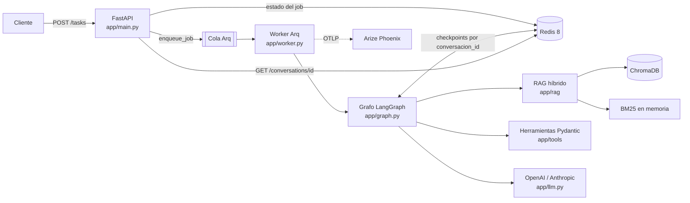
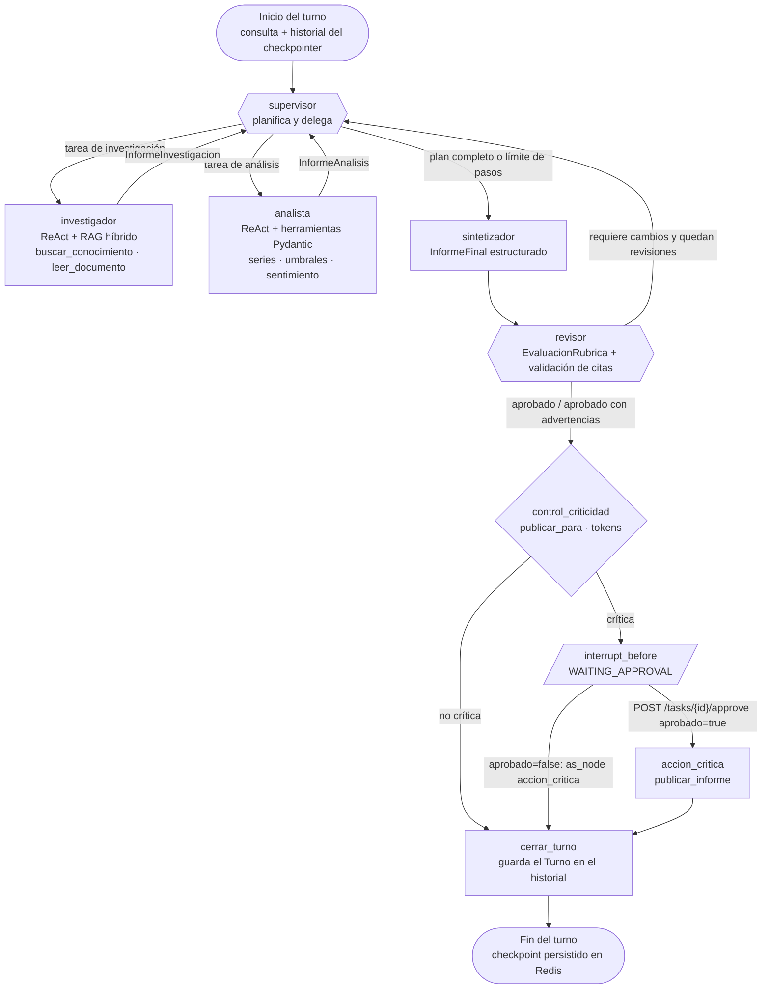

# The Intelligence System

Sistema de IA de grado producción para EcoRuta, un operador ficticio de monopatines eléctricos en Buenos Aires, que responde consultas de negocio.

Una consulta entra por una **API FastAPI** que no bloquea: la encola en **Arq** y responde `202` al instante. Un **worker** ejecuta un **grafo de LangGraph** donde un **supervisor** planifica y delega en especialistas. El **investigador** consulta un **RAG híbrido** (ChromaDB + BM25). El **analista** calcula con **herramientas validadas con Pydantic**. El **sintetizador** redacta y el **revisor** audita las citas.

Cada conversación se guarda en un **checkpointer de LangGraph sobre Redis**, así que sobrevive a reinicios y admite preguntas de seguimiento. Las acciones con efectos externos se pausan hasta que un **humano las aprueba**. Cada ejecución deja su árbol de spans, tokens y costo en **Arize Phoenix**.

- Python 3.12+ · FastAPI · LangGraph · Arq · Redis 8 · ChromaDB · Arize Phoenix
- Todo el flujo es `async`: endpoints, worker, nodos del grafo, herramientas, embeddings, ChromaDB y Redis.
- Toda entrada y salida está validada con Pydantic: API, herramientas, contratos entre agentes y configuración.
- Sin hard-coding: modelos, colección del índice, URLs y límites salen de variables de entorno (`app/settings.py`, `.env.example`).

## Despliegue local con una instrucción

```bash
cp .env.example .env
./run.sh
```

En Windows (PowerShell): `.\run.ps1`

Hay que completar `OPENAI_API_KEY` en `.env`. El script valida `.env`, ejecuta `docker compose up --build -d` y espera a que la API y el worker estén sanos.

| Servicio | URL | Rol |
|---|---|---|
| api | http://localhost:8000/docs | FastAPI (Swagger) |
| worker | — | Arq: ejecuta el grafo de agentes |
| redis | localhost:6379 | Redis 8: cola, estado de jobs y checkpoints de LangGraph |
| chroma | localhost:8001 | Índice vectorial del RAG |
| phoenix | http://localhost:6006 | Trazas, latencia, tokens y costo |

## Arquitectura



De dónde sale cada pieza:

| Capa | Archivos | Origen |
|---|---|---|
| Cliente LLM asíncrono con timeouts y reintentos (OpenAI / Anthropic por variable de entorno) | `app/llm.py`, `app/settings.py` | Módulo 1 |
| Cadenas LCEL con contratos Pydantic (`prompt \| llm.with_structured_output(...)`) | `app/agents/contratos.py`, `app/agents/supervisor.py`, `app/agents/synthesizer_agent.py`, `app/agents/reviewer_agent.py` | Módulo 2 |
| Ingesta con metadatos, fragmentación por tokens e índice en ChromaDB | `app/rag/documentos.py`, `app/rag/ingesta.py` | Módulo 3 |
| Recuperación híbrida vectorial + BM25 con re-ranking RRF, como herramienta del investigador | `app/rag/recuperador.py`, `app/tools/busqueda.py` | Módulo 4 |
| Agentes ReAct con herramientas | `app/agents/research_agent.py`, `app/agents/analyst_agent.py`, `app/tools/analisis.py` | Módulo 5 |
| Supervisor que planifica, delega y corrige con el revisor | `app/agents/supervisor.py`, `app/agents/reviewer_agent.py`, `app/graph.py` | Módulo 6 |
| API, Redis, worker Arq, HITL y trazas | `app/main.py`, `app/worker.py`, `app/jobs.py`, `app/hitl.py`, `app/observability.py` | Módulo 7 |
| Checkpointer persistente y conversaciones multi-turno | `app/graph.py`, `app/agents/state.py` | Proyecto final |

## Decisiones de arquitectura

| Decisión | Alternativa descartada | Por qué |
|---|---|---|
| La API encola en Arq y un worker separado ejecuta el grafo | Ejecutar el grafo dentro del request de FastAPI | Una ejecución multi-agente tarda decenas de segundos. Encolar mantiene la API en milisegundos, limita la concurrencia con `MAX_JOBS` y permite escalar workers sin tocar la API. |
| Supervisor planificador con plan explícito (`TareaPlan`) | Supervisor que solo elige el próximo agente | El plan queda en el estado y en las trazas. El supervisor reintenta una tarea fallida hasta `MAX_INTENTOS_POR_TAREA` y corta en `MAX_PASOS_SUPERVISOR`, así que no hay bucles infinitos. |
| Revisor con rúbrica y validación determinística de citas | Confiar en la respuesta del sintetizador | Un LLM puede citar documentos que no existen o inventar cifras. Antes de la rúbrica, controles determinísticos verifican que cada `doc_id` exista y que cada cifra del informe esté respaldada por los aportes de los especialistas. Si no alcanza `PUNTAJE_MINIMO_RUBRICA`, el informe vuelve al supervisor. |
| RAG híbrido vectorial + BM25 fusionados con RRF | Solo búsqueda vectorial | Las consultas de negocio tienen cifras, siglas y nombres propios (NPS, VoltSur, Q3) que BM25 encuentra mejor que los embeddings. RRF combina los rankings sin calibrar puntajes de escalas distintas. |
| Ingesta idempotente por huella del corpus | Reindexar en cada arranque | El worker arranca rápido y no paga embeddings de más. Solo reindexa si cambian los documentos. |
| `thread_id` = `conversacion_id` y canales de trabajo reiniciados con `Overwrite` | Un hilo nuevo por job | La conversación conserva su historial (`turnos`, con reducer acumulativo) y cada turno arranca con un plan limpio sin arrastrar aportes viejos. |
| Bloqueo por conversación (`SET NX`) | Permitir turnos simultáneos en el mismo hilo | Dos turnos concurrentes sobre el mismo checkpoint producirían un historial inconsistente. La API responde `409`. |
| HITL con `interrupt_before` en un nodo dedicado | Pedir confirmación dentro de la herramienta | La pausa queda en el checkpoint, así que la aprobación puede llegar horas después o a otro worker. Rechazar usa `as_node`, sin ejecutar el efecto secundario. |
| Estado del job en Redis con transiciones `WATCH`/`MULTI` | Leer el estado desde el checkpoint | El job (`PENDING` → `RUNNING` → `WAITING_APPROVAL` → `DONE`) es el contrato con el cliente HTTP y se actualiza atómicamente aunque haya varios workers. |
| Tracer provider de Phoenix no global y span raíz por ejecución con `session.id` | Instrumentación global | Se exportan solo las trazas del sistema de agentes, y cada conversación aparece agrupada como sesión en Phoenix. |

## Grafo de agentes



Versión en imagen: [`docs/grafo.png`](docs/grafo.png) (fuente: [`docs/grafo.mmd`](docs/grafo.mmd)).

- **supervisor**: arma un plan (`DecisionSupervisor`, `TareaPlan`) y en cada paso decide a qué especialista delegar. Recibe los últimos `TURNOS_DE_CONTEXTO` turnos de la conversación para resolver referencias como "¿y en el trimestre anterior?". Corta en `MAX_PASOS_SUPERVISOR`.
- **investigador**: agente ReAct que solo responde con lo que recupera del RAG y cita los `doc_id`. Devuelve `InformeInvestigacion`.
- **analista**: agente ReAct que calcula con herramientas tipadas: validación de series, estadísticas, crecimiento, umbrales y sentimiento por aspecto. Devuelve `InformeAnalisis`.
- **sintetizador** y **revisor**: el sintetizador arma el `InformeFinal`. El revisor lo evalúa con una rúbrica y verifica que cada cita exista en la base de conocimiento. Si el puntaje no alcanza, vuelve al supervisor (hasta `MAX_REVISIONES`).
- **control_criticidad** y **accion_critica**: si la tarea publica a destinatarios o supera `UMBRAL_TOKENS_APROBACION`, el grafo se pausa antes de `accion_critica` y espera la decisión humana.
- **cerrar_turno**: agrega el turno (consulta, respuesta y estado) al historial de la conversación.

## API

| Método | Ruta | Descripción |
|---|---|---|
| `POST` | `/tasks` | Encola un turno. Devuelve `202` con `job_id` y `conversacion_id`. Si se envía un `conversacion_id` existente, continúa esa conversación. Devuelve `409` si esa conversación ya tiene un turno en curso. |
| `GET` | `/tasks/{job_id}` | Estado (`PENDING`, `RUNNING`, `WAITING_APPROVAL`, `DONE`, `REJECTED`, `FAILED`), progreso por nodo, resultado, consumo de tokens y solicitud de aprobación. |
| `POST` | `/tasks/{job_id}/approve` | Decisión humana `{aprobado, revisor, comentario}`. Devuelve `409` si la tarea no espera aprobación. |
| `GET` | `/tasks` | Lista de tareas, con filtro opcional por estado. |
| `GET` | `/conversations/{conversacion_id}` | Historial de turnos leído **del checkpointer** de LangGraph. |
| `GET` | `/health` | Redis, tareas en cola, latido del worker, checkpointer, observabilidad y modelo. |

```bash
curl -X POST localhost:8000/tasks -H "Content-Type: application/json" \
  -d '{"consulta": "¿Cómo evolucionaron los viajes de EcoRuta en el tercer trimestre de 2026?"}'

curl -X POST localhost:8000/tasks -H "Content-Type: application/json" \
  -d '{"consulta": "¿Y cómo se compara con el segundo trimestre?", "conversacion_id": "<conversacion_id>"}'
```

## RAG híbrido

- **Base de conocimiento**: 10 documentos Markdown en `data/conocimiento/` con frontmatter (`doc_id`, `tipo`, `titulo`, `fecha`): informes operativos, encuesta, tickets, prensa, plan de expansión, tarifario, manual y políticas.
- **Ingesta idempotente** (`app/rag/ingesta.py`): fragmentos de `CHUNK_TOKENS` tokens con solapamiento, contados con tiktoken. Cada fragmento lleva el título de su sección. La huella SHA-256 del corpus queda en la metadata de la colección, así que el worker solo reindexa si los documentos cambiaron.
- **Recuperación** (`app/rag/recuperador.py`): búsqueda vectorial en ChromaDB (`chromadb.AsyncHttpClient`, embeddings `EMBEDDING_MODEL`) y BM25, fusionadas con Reciprocal Rank Fusion ponderada (`RAG_PESO_VECTORIAL`). Se puede filtrar por tipo de documento.

## Async

- **API**: FastAPI con `lifespan` asíncrono. Redis, el pool de Arq y el checkpointer se abren con `AsyncExitStack`.
- **Worker**: Arq con `max_jobs` ejecuciones simultáneas y un timeout por ejecución. Cada ejecución aplica `asyncio.wait_for`. Una cancelación se registra con `asyncio.shield` para que el job nunca quede en `RUNNING`.
- **Grafo y herramientas**: el grafo se recorre con `astream`, y todos los nodos y herramientas son `async`. Los embeddings usan `aembed_*` y ChromaDB usa el cliente HTTP asíncrono.
- **Estado de los jobs**: transiciones atómicas con `WATCH`/`MULTI` en Redis. Cada conversación tiene un bloqueo `SET NX` para que no haya dos turnos simultáneos sobre el mismo hilo.

## Validación con Pydantic

- **API** (`app/api_schemas.py`): `NuevaTarea` con largo de consulta, patrón de `conversacion_id` y máximo de destinatarios. También `DecisionHumana`, `VistaTarea`, `Conversacion` y `Salud` como `response_model`.
- **Herramientas** (`app/tools`): cada una declara `args_schema` (`EntradaBusqueda`, `EntradaLectura`, `EntradaSerie`, `EntradaUmbral`, `EntradaTextos`) y devuelve un modelo (`ResultadoBusqueda`, `Estadisticas`, `AnalisisSentimiento`, etc.). Una entrada inválida vuelve al agente como error de validación, en lugar de romper la ejecución.
- **Agentes**: los nodos se comunican con contratos tipados (`app/agents/contratos.py`) usando `response_format`.
- **Configuración**: `pydantic-settings` con rangos validados (`app/settings.py`).

## Persistencia: el checkpointer

El grafo se compila con un checkpointer de LangGraph. El `thread_id` es el `conversacion_id`, así que cada turno continúa el estado del anterior.

| `CHECKPOINTER` | Implementación | Uso |
|---|---|---|
| `redis` (por defecto) | `AsyncRedisSaver`, con TTL `CHECKPOINT_TTL_MINUTOS` | Docker Compose (Redis 8) |
| `sqlite` | `AsyncSqliteSaver` | Desarrollo local sin Redis 8 |
| `memory` | `InMemorySaver` | Pruebas: se pierde al reiniciar |

Al empezar cada turno, los canales de trabajo (plan, aportes, revisiones, pasos) se reinician con `Overwrite`. El historial `turnos` se acumula con un reducer, así que la conversación crece y cada turno arranca con un plan limpio.

Demostración de que las conversaciones sobreviven a un reinicio:

```bash
curl -X POST localhost:8000/tasks -H "Content-Type: application/json" \
  -d '{"consulta": "¿Cuál fue la utilización de la flota de EcoRuta en septiembre de 2026?"}'
docker compose restart api worker
curl localhost:8000/conversations/<conversacion_id>
curl -X POST localhost:8000/tasks -H "Content-Type: application/json" \
  -d '{"consulta": "¿Y cuál había sido en junio?", "conversacion_id": "<conversacion_id>"}'
```

El turno 1 sigue en `GET /conversations/{id}` después del reinicio. El turno 2 se resuelve usando ese contexto.

## Observabilidad con Arize Phoenix

- `LangChainInstrumentor` traza cada llamada LLM, agente, herramienta y nodo del grafo, con tokens, latencia y costo.
- Cada ejecución del worker abre un span raíz `tarea.ejecucion` o `tarea.reanudacion` con `session.id = conversacion_id`. En la pestaña **Sessions** se ve una conversación completa, incluidos los turnos y la pausa y reanudación del HITL.
- La evaluación de criticidad es un span propio (`hitl.evaluar_criticidad`).
- El tracer provider no es global, así que solo se exportan las trazas del sistema de agentes.

Las capturas están en [`screenshots/`](screenshots/README.md).

## Pruebas del sistema

```bash
pip install httpx pydantic
python scripts/pruebas_sistema.py
```

Cinco pruebas de punta a punta contra la API levantada. Cada una deja sus trazas en Phoenix como una sesión.

1. **Análisis completo RAG + agentes**: plan, investigación, análisis, síntesis y revisión aprobada.
2. **Conversación de dos turnos**: el segundo turno usa el historial y los dos quedan en el checkpointer.
3. **Pregunta fuera del conocimiento**: no inventa datos de una ciudad donde EcoRuta no opera.
4. **Tarea crítica aprobada**: pausa en `WAITING_APPROVAL` y publica después de la aprobación.
5. **Tarea crítica rechazada**: termina en `REJECTED` sin ejecutar la publicación.

El script guarda el detalle en `resultados/` y reescribe esta tabla:

<!-- PRUEBAS -->
Se completa al ejecutar `python scripts/pruebas_sistema.py`.
<!-- /PRUEBAS -->

## Concurrencia

```bash
python scripts/prueba_carga.py -n 5
```

Lanza 5 consultas en paralelo y mide el encolado de `POST /tasks`, la ejecución en el worker (p50 y p95) y los tokens por nodo:

<!-- RESULTADOS_CARGA -->
Se completa al ejecutar `python scripts/prueba_carga.py`.
<!-- /RESULTADOS_CARGA -->

## Variables de entorno

Todas están en `.env.example`. Docker Compose sobrescribe las direcciones internas (`REDIS_URL`, `CHROMA_HOST`, `CHROMA_PORT`, `PHOENIX_COLLECTOR_ENDPOINT`).

| Grupo | Variables |
|---|---|
| Modelo | `LLM_PROVIDER`, `LLM_MODEL`, `OPENAI_API_KEY`, `ANTHROPIC_API_KEY`, `LLM_TEMPERATURE`, `LLM_MAX_TOKENS`, `LLM_TIMEOUT_SEGUNDOS`, `LLM_MAX_REINTENTOS` |
| RAG | `EMBEDDING_MODEL`, `CHROMA_HOST`, `CHROMA_PORT`, `CHROMA_COLLECTION`, `CHUNK_TOKENS`, `CHUNK_OVERLAP_TOKENS`, `RAG_TOP_K`, `RAG_PESO_VECTORIAL` |
| Persistencia | `REDIS_URL`, `CHECKPOINTER`, `CHECKPOINT_TTL_MINUTOS`, `JOB_TTL_SEGUNDOS` |
| Worker | `MAX_JOBS`, `JOB_TIMEOUT_SEGUNDOS` |
| Observabilidad | `OBSERVABILIDAD`, `PHOENIX_COLLECTOR_ENDPOINT`, `PHOENIX_PROJECT_NAME` |
| Agentes | `MAX_PASOS_SUPERVISOR`, `MAX_INTENTOS_POR_TAREA`, `MAX_REVISIONES`, `PUNTAJE_MINIMO_RUBRICA`, `RECURSION_LIMIT_GRAFO`, `RECURSION_LIMIT_ESPECIALISTA`, `TURNOS_DE_CONTEXTO`, `UMBRAL_TOKENS_APROBACION` |

## Ejecución sin Docker

Requiere Python 3.12 o superior (`requires-python` en `pyproject.toml`).

```bash
python -m venv .venv
source .venv/bin/activate
pip install -r requirements.txt
docker compose up -d redis chroma phoenix
arq app.worker.WorkerSettings
uvicorn app.main:app --port 8000
```

`arq` y `uvicorn` van en terminales separadas. Si no hay Redis 8 disponible, usar `CHECKPOINTER=sqlite`.

## Estructura

```
app/
  main.py            API FastAPI
  worker.py          Worker Arq
  graph.py           Grafo, checkpointer y entrada de cada turno
  hitl.py            Criticidad, pausa y decisión humana
  jobs.py            Estado de jobs y bloqueo por conversación en Redis
  observability.py   Arize Phoenix
  metrics.py         Tokens y duración por nodo
  api_schemas.py     Modelos de la API
  settings.py        Configuración por variables de entorno
  llm.py             Fábrica de modelos de chat y embeddings
  agents/            Supervisor, especialistas, revisor, estado y contratos
  rag/               Documentos, ingesta y recuperador híbrido
  tools/             Herramientas de búsqueda y análisis
data/conocimiento/   Base de conocimiento
scripts/             Pruebas de punta a punta y prueba de concurrencia
docs/                Diagrama del grafo
screenshots/         Evidencia de Phoenix
```
